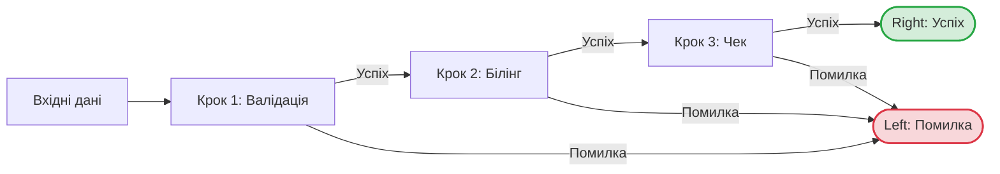
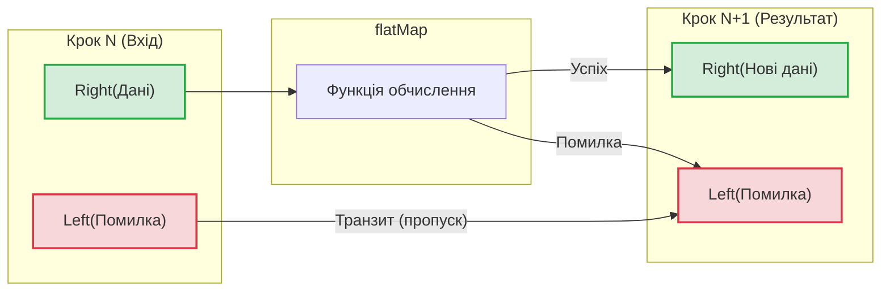

# Лекція 03. Залізничне програмування (Railway-Oriented): Смерть `null` та `Exceptions`, Безпека з `Option`, `Either`, `Try` та елегантний `for-comprehension`

> **Декларація курсу.** Академічна доброчесність та авторство матеріалів — у [DISCLAIMER.md](DISCLAIMER.md).  
> **Місток курсу:** У [Лекції 02](02_first_class_functions.md) ми замінили цикли на чисті трансформації `map`, `filter`, `fold`. Але що робити, коли програма стикається з недосконалим реальним світом (битий JSON, відсутній користувач, мережевий таймаут)? **Як обробляти помилки без підступного `null` та руйнівних `Exceptions`?**

### Чому саме «залізничне»? (Метафора Скотта Влашина)

Термін **Railway-Oriented Programming (ROP)** ввів британський архітектор **Скотт Влашин (Scott Wlaschin)**, автор культової книги *«Domain Modeling Made Functional»*. 

Замість академічної математики про «монадичні стрілки над функтором Either», Скотт запропонував наочну модель **двох паралельних залізничних колій**:

1. **Функція, що може впасти, — це залізнична стрілка:** вона приймає дані на вході, але має два виходи: зелену колію (успіх, `Right`) та червону колію (помилка, `Left`).
2. **Композиція колій:** поєднуючи функції через `flatMap` (або `for-comprehension`), ми будуємо суцільну залізницю.
3. **Рух потяга:**
   - Поки все добре — потяг мчить зеленою колією крок за кроком.
   - Якщо на будь-якому кроці стається збій (невалідний email, дублікат логіна) — «стрілка» **перемикає потяг на червону колію**.
   - Усі наступні кроки потяг **пролітає транзитом без виконання**, безпечно довозячи опис помилки до фінального обробника.

**Мета лекції:** Навчитися проектувати такі надійні пайплайни без `if (x == null)` та спагеті з `try-catch`. Замінити небезпечні винятки на чесні типи-контейнери (**`Option`**, **`Either`**, **`Try`**) та керувати рухом по коліях через елегантний **`for-comprehension`**.

> **Термінологічна довідка: Чому саме «comprehension», а не «loop»?**  
> Термін прийшов із математичної логіки та теорії множин (*Set Comprehension* — опис множини через формулу/правило, а не прямим переліком елементів).  
> * **Loop (цикл):** керуюча інструкція (*statement*). Вона виконує блок коду задану кількість разів і сама по собі не повертає значення (потребує мутації зовнішніх змінних чи буферів).  
> * **Comprehension:** функціональний вираз (*expression*). Він **конструює нове значення** з наявних контейнерів без змінних та побічних ефектів (`for ... yield` розгортається у `flatMap` та `map`).

---

## Питання для розминки

<details markdown="1">
<summary>1. Чому винахідник null сер Тоні Гоар публічно назвав його своєю «помилкою на мільярд доларів»?</summary>

У 1965 році сер Тоні Гоар додав посилання `null` у мову ALGOL W просто тому, що це було легко реалізувати в компіляторі. Згодом це породило незліченну кількість помилок `NullPointerException`, дірок у безпеці та аварій систем, ліквідація яких коштувала світовій IT-індустрії мільярдів доларів і людино-років.
</details>

<details markdown="1">
<summary>2. Чому оператор throw new Exception() вважається «брехнею в сигнатурі методу»?</summary>

Погляньте на сигнатуру: `def parseAge(raw: String): Int`. Вона урочисто обіцяє: *«Дай мені рядок, і я обов'язково поверну ціле число»*. Але якщо передати `"abc"`, метод викине `NumberFormatException` і обвалить потік. Функція **збрехала** — вона не повернула `Int`. У чистому ФП сигнатура завжди чесна: `def parseAge(raw: String): Option[Int]` прямо попереджає про можливість відсутності результату.
</details>

<details markdown="1">
<summary>3. Чому вираз 2 + 2 можна сміливо замінити на 4 будь-де в коді, а функцію з throw Exception — ні? (Що таке референтна прозорість)</summary>

У **теорії мов програмування (PLT)** це називають **референтною прозорістю (Referential Transparency)** — або «тестом на підстановку» («Ctrl+C / Ctrl+V»):

- **Передбачуваний код:** якщо замінити виклик чистої функції `calculateTax(100)` на вже пораховане значення `20`, логіка програми взагалі не зміниться. Вираз повністю еквівалентний своєму результату.
- **Код із винятками (`throw`):** ви не можете замінити виклик функції її результатом, бо вона може здетонувати посеред обчислень, перервати стек викликів і обвалити потік. 

У залізничному програмуванні замість прихованих «бомб» (`throw`) функції завжди повертають чесні контейнери (`Option` або `Either`), зберігаючи передбачуваність коду.
</details>

---

## 1. Архітектурний кейс: Каскадний рестарт Pod-ів через "невинний" `NullPointerException`

**Контекст:** Мікросервіс автопідбору готелю обробляє вихідний потік партнерів у кластері Kubernetes (20 000 користувачів онлайн).  
Сервіс отримував профіль клієнта і генерував рекомендації:

```java
// Класичний небезпечний Java-код:
public String getCityUpper(User user) {
    return user.getAddress().getCity().toUpperCase();
}
```

### Що пішло не так:
1. Новий партнер надіслав валідний JSON, де поле `"address"` було пропущене (`null`).
2. Виклик `user.getAddress().getCity()` миттєво викинув `java.lang.NullPointerException`.
3. Необроблений виняток аварійно скидав запити з HTTP 500.
4. Лавина NPE змусила JVM невпинно формувати стектрейси (`fillInStackTrace`) та писати кілометри логів: CPU стрибнув до 100%, виникли відчутні Stop-The-World GC-паузи.
5. Через дефіцит CPU health-check сервісу `HTTP GET /health` перестав відповідати у відведений таймаут (1s).
6. Kubernetes Liveness Probe вирішив, що сервіс завис, і почав агресивно перезапускати поди.
7. Каскадна хвиля рестартів (CrashLoopBackOff) поклала весь кластер на 40 хвилин.

```scala
// Функціональний код на Scala (NPE неможливий фізично):
case class Address(city: Option[String])
case class User(address: Option[Address])

def getCityUpper(user: User): Option[String] =
  user.address.flatMap(_.city).map(_.toUpperCase)
```

**Інженерний висновок:**  
Якщо тип поля `Option[Address]`, компілятор **примушує** вас явно обробити випадок відсутності даних. Забути про `None` неможливо — код просто не скомпілюється!

---

## 2. Контейнер `Option[T]`: Цивілізована відмова від `null`

Тип `Option[T]` — це закрита коробка, в якій або є рівно одне значення, або немає нічого:

```
                  ┌──────────────┐
                  │  Option[T]   │
                  └──────┬───────┘
                         │
           ┌─────────────┴─────────────┐
           ▼                           ▼
      Some(value)                    None
 (Значення присутнє)          (Значення відсутнє)
```

### Як правильно працювати з `Option`:

```scala
val ageFound: Option[Int] = "25".toIntOption   // Some(25)
val ageBroken: Option[Int] = "NaN".toIntOption // None

// 1. Дефолтне значення через getOrElse:
val safeAge: Int = ageBroken.getOrElse(18) // 18

// 2. Безпечна трансформація через map:
val nextYearAge: Option[Int] = ageFound.map(_ + 1) // Some(26)

// 3. Згортка через fold:
val message: String = ageBroken.fold("Вік не вказано")(a => s"Вік: $a") // "Вік не вказано"

// 4. Явний розбір через pattern matching:
val status: String = ageFound match
  case Some(age) => s"Користувачу $age років"
  case None      => "Вік невідомий"
```

> **Смертний гріх початківця:** Ніколи не викликайте `option.get`!  
> Якщо там `None`, ви отримаєте `NoSuchElementException`, що є тим самим `NullPointerException`, тільки з іншою назвою. Використовуйте `getOrElse`, `fold` або `match`.

---

## 3. Контейнер `Try[T]`: Приборкання диких Java-винятків

Коли ми інтегруємося зі старими Java-бібліотеками, які кидають винятки (`SQLException`, `MalformedURLException`), ми не ловимо їх через громіздкий блок `try-catch`. Ми загортаємо їх у функціональний контейнер `Try`.

### 3.1. Ієрархія типів: Як влаштований `Try` та його зв'язок із JVM `Throwable`

У стандартній бібліотеці Scala (`scala.util.Try`) цей контейнер є класичним ADT із двох варіантів:

```scala
sealed abstract class Try[+T]
case class Success[+T](value: T)             extends Try[T]
case class Failure[+T](exception: Throwable) extends Try[T]
```

* **`Success(value)`** — обчислення успішне, містить результат типу `T`.
* **`Failure(exception)`** — обчислення впало; виняток перехоплено і збережено як об'єкт типу `Throwable`.

> **Що означає префікс `+T`? (Коваріантність / Covariance)**  
> Плюсик перед параметром типу означає, що **наслідування контейнерів повторює наслідування типів усередині них**:  
> Якщо `Dog` є спадкоємцем `Animal` (`Dog <: Animal`), то й `Try[Dog]` автоматично є спадкоємцем `Try[Animal]`.  
> * **У Java** для цього доводиться щоразу писати вайлдкарди у викликах: `Try<? extends Animal>` (*use-site variance*). У Scala це декларується один раз у самому класі (*declaration-site variance*).  
> * **Чому це безпечно:** Оскільки контейнер незмінний (*immutable*), з нього можна лише читати дані, тому прочитаний `Dog` завжди гарантовано є валідним `Animal`.

#### Звідки береться `Throwable`? Ієрархія помилок JVM
У платформі Java/JVM будь-який об'єкт, який можна «викинути» через `throw`, зобов'язаний бути нащадком класу **`java.lang.Throwable`**:

* **`java.lang.Throwable`** (корінь усіх помилок у JVM):
  * **`java.lang.Error`** — фатальні збої віртуальної машини (`OutOfMemoryError`, `StackOverflowError`). Стан пам'яті незворотно пошкоджено.
  * **`java.lang.Exception`** — помилки виконання програми та оточення:
    * **`RuntimeException`** (Unchecked): `NullPointerException`, `IllegalArgumentException`.
    * **Checked Exceptions** (у Java): `IOException`, `SQLException`.

> **Як `Try` захищає JVM від падіння:**  
> Конструктор `Try(unsafeCode)` під капотом перехоплює лише **нефатальні** помилки (`scala.util.control.NonFatal`).  
> Фатальні системні збої (`Error`, як-от `OutOfMemoryError` чи `ThreadDeath`) навмисно **не перехоплюються** і летять далі, щоб аварійно зупинити JVM і не продовжувати роботу в пошкодженому стані пам'яті. Усі інші винятки (`Exception`) безпечно упаковуються у `Failure(e: Throwable)`.

### Як правильно працювати з `Try`:

```scala
import scala.util.{Try, Success, Failure}

def parseUrl(raw: String): Try[java.net.URI] =
  Try(new java.net.URI(raw))

parseUrl("https://onu.edu.ua") // Success(https://onu.edu.ua)
parseUrl("не валідний url :: ") // Failure(java.net.URISyntaxException: ...)
```

* **`Success(v)`** — обчислення пройшло успішно, всередині лежить значення `v: T`.
* **`Failure(e)`** — виняток перехоплено і збережено як об'єкт `e: Throwable`. Потік виконання не обірвано, система не падає.

#### Інженерний місток: Від сирого `Try` до доменного `Either`

Чому сирий `Try[T]` є небажаним у чистому бізнес-шарі?  
`Try` жорстко прив'язаний до **`Throwable`** (`Failure(e: Throwable)`). Це несе дві архітектурні проблеми:
1. **Витік деталей реалізації (Abstraction Leak):** Клієнту чи сервісу замовлень не потрібен сирий `java.net.SocketTimeoutException` чи `SQLException`. Йому потрібні чіткі доменні поняття: `PaymentGatewayTimeout`, `OrderNotFound`.
2. **`Throwable` занадто широкий і небезпечний:** у нього входять фатальні системні помилки типу `OutOfMemoryError` або `VirtualMachineError`, які бізнес-логіка взагалі не повинна намагатися «обробляти».

**Інженерне рішення:** на стику із зовнішнім світом ми конвертуємо сирий `Try` за допомогою методу **`.toEither`** у контейнер **`Either`** — структуру, яка містить **або `Left` (помилка), або `Right` (успіх)**.

##### Чому саме `Left` та `Right`? Мнемоніка «Right is right»
Контейнер `Either` представляє розгалуження на дві альтернативи: `Left` (ліворуч) та `Right` (праворуч).  
При виклику `.toEither` бібліотека Scala автоматично розкладає результат по коліях:
* `Success(v)` перетворюється на **`Right(v)`** (успіх).
* `Failure(e)` перетворюється на **`Left(e: Throwable)`** (помилка).

Чому саме так? В `Either` діє непорушна конвенція функціонального програмування:
* **Right is right:** права колія зарезервована під успішне значення (**Right** англійською означає як «правий», так і «правильний»).
* **Left:** ліва колія за домовленістю відведена під помилку або відхилення від основного сценарію.

Оскільки у `Left` після конвертації все ще сидить технічний `Throwable`, ми застосовуємо метод **`.left.map(...)`**: він трансформує **виключно ліву колію**, замінюючи сирий виняток на нашу бізнес-помилку.

---

##### Порівняння: Java (Exceptions) vs Scala (Railway Oriented)

**Java: Імперативні винятки (приховані бомби, спагеті з try-catch):**
```java
// У Java доводиться або городити кастомні RuntimeExceptions,
// або перевантажувати сигнатуру checked exceptions (throws):
public UserDto fetchUserData(String userId) {
    try {
        String json = legacyHttpClient.get("/users/" + userId);
        return jsonParser.parse(json);
    } catch (SocketTimeoutException e) {
        // Виняток обриває потік виконання, компілятор не контролює обробку викликачем:
        throw new DomainTimeoutException("Сервіс не відповів", e);
    } catch (IOException e) {
        throw new DomainTechnicalException("Помилка мережі", e);
    }
}
```

**Scala: Залізнична трансформація (явні типи, збереження потоку):**
```scala
// 1. Доменна модель помилок (строгий закритий перелік через Enum):
enum ApiError:
  case NetworkTimeout(msg: String)
  case ServiceUnavailable(cause: Throwable)

// 2. Чиста обгортка на стику з ненадійною Java:
def fetchUserData(userId: String): Either[ApiError, UserDto] =
  Try(legacyHttpClient.get(s"/users/$userId"))
    .toEither                    // Отримуємо Either[Throwable, String]
    .left.map {                  // Перетворюємо технічний Throwable -> бізнес-помилку ApiError:
      case _: java.net.SocketTimeoutException =>
        ApiError.NetworkTimeout("Сервіс не відповів вчасно")
      case ex =>
        ApiError.ServiceUnavailable(ex)
    }
    .flatMap(json => parseUserJson(json)) // Якщо Right — парсимо. Якщо Left — пропускаємо крок і повертаємо помилку.
```

### 3.2. Автоматичне вивільнення ресурсів: `scala.util.Using` замість `try-finally`

У реальних додатках робота з файлами, сокетами чи з'єднаннями з БД потребує не лише безпечного перехоплення помилок, а й **гарантованого закриття системних дескрипторів**.  
В імперативній практиці забутий `.close()` призводить до аварії операційної системи — вичерпання дескрипторів (**`java.io.IOException: Too many open files`**) та падіння JVM.

У Scala для ідіоматичного керування життєвим циклом ресурсів використовується бібліотека **`scala.util.Using`**:

```scala
import scala.io.Source
import scala.util.{Try, Using}

// Варіант А: Using.resource — повертає чистий результат і гарантує виклик .close():
val linesCount: Int = Using.resource(Source.fromFile("data.csv")) { source =>
  source.getLines().size
}

// Варіант Б: Using(...) — безпечно загортає результат і винятки I/O у контейнер Try:
val safeLines: Try[List[String]] = Using(Source.fromFile("data.csv")) { source =>
  source.getLines().toList
}
```

#### Чому це краще за класичний Java `try-finally`:
* **Повна сумісність із бібліотеками Java:** `Using` підтримує будь-який клас, що реалізує стандартний Java-інтерфейс `java.lang.AutoCloseable` (`InputStream`, `Connection`, `Socket`, `Source`).
* **Збереження першопричини (без маскування помилок):** У класичному `try-finally`, якщо падала бізнес-логіка, а потім ще й метод `.close()`, виняток закриття повністю **стирав первинну помилку**. `Using` зберігає бізнес-помилку як головну, а помилку закриття підшиває поруч (механізм *Suppressed Exceptions*):

  ```java
  // Проблема старого Java try-finally:
  Connection conn = pool.getConnection();
  try {
      conn.execute("UPDATE ..."); // Викидає SQLException ("Deadlock")
  } finally {
      conn.close();               // Викидає SocketException ("Broken pipe")
      // Катастрофа: SQLException стерто! У логах буде лише SocketException.
  }
  ```

  ```scala
  // Вирішення у Scala Using:
  Using(pool.getConnection()) { conn =>
    conn.execute("UPDATE ...") // Якщо впаде і запит, і закриття з'єднання:
  }
  // Результат у Failure(e):
  // e -> SQLException ("Deadlock") — збережено як ГОЛОВНИЙ виняток.
  // e.getSuppressed -> Array(SocketException) — підшито поруч.
  ```

* **Використання у курсі:** Саме за допомогою `Using.resource(Source.fromFile(path))` ми безпечно завантажуємо медичний датасет у [Практиці 05: Main.scala](p05_heart_disease_triage.md), виключаючи витік пам'яті та дескрипторів.

---

## 4. Концепція Railway-Oriented Programming (ROP) на `Either`

Коли стається збій, `Option` повертає лише `None` і не дає інформації про причину помилки.  
Для багатокрокової бізнес-логіки використовують **`Either[Error, Success]`** — метафору двох залізничних колій (Скотт Влашин).



* **Зелена колія (`Right`):** Усе добре, поїзд рухається далі до наступної станції. *(Англійська гра слів: «Right is correct»)*.
* **Червона колія (`Left`):** Сталася помилка. Стрілка перемикається, поїзд з'їжджає на аварійну колію і **автоматично минає всі наступні кроки**, зберігаючи причину збою.

### Приклад із життя: Реєстрація користувача

```scala
enum RegistrationError:
  case WeakPassword(reason: String)
  case InvalidEmail(email: String)
  case UserAlreadyExists(login: String)

def validateEmail(email: String): Either[RegistrationError, String] =
  if email.contains("@") then Right(email)
  else Left(RegistrationError.InvalidEmail(email))

def validatePassword(pass: String): Either[RegistrationError, String] =
  if pass.length >= 8 then Right(pass)
  else Left(RegistrationError.WeakPassword("Пароль має містити мінімум 8 символів"))
```

### 4.1. Пакетна залізнична обробка: Анатомія методу `partitionMap`

Що робити, коли на вхід надходить не одна транзакція, а батч із 100 000 записів, кожен із яких валідується у `Either[ParsingError, Transaction]`?

#### Антипатерн джуніора: Подвійний `.filter`
Часто початківці намагаються розділити успіхи та помилки так:
```scala
val parsed: List[Either[ParsingError, Transaction]] = rawLines.map(parse)

// ПОГАНО: Два проходи по пам'яті + ручне розпакування!
val errors = parsed.filter(_.isLeft).map { case Left(e) => e }
val valids = parsed.filter(_.isRight).map { case Right(v) => v }
```
* **Чому це неприйнятно в High-Load:**
  1. **$2 \times N$ операцій:** Список із 100 000 елементів ітерується двічі, створюючи зайві проміжні масиви та навантажуючи Garbage Collector.
  2. **Багатослівність:** Потрібно вручну фільтрувати, а потім окремим кроком розпаковувати `Left`/`Right` через pattern matching.

#### Ідіоматичний підхід: метод `partitionMap` (Scala 2.13 / Scala 3)
Стандартна бібліотека Scala має спеціальний високоефективний метод для залізничного розділення:
```scala
def partitionMap[A1, A2](f: A => Either[A1, A2]): (List[A1], List[A2])
```

Він виконує **розділення та розпакування рівно за один прохід ($O(N)$)** у кортеж двох окремих списків `(List[A1], List[A2])`:
* Якщо елемент повернув `Left(err)` — значення `err` розпаковується і потрапляє у перший список `List[A1]` (помилки).
* Якщо елемент повернув `Right(val)` — значення `val` розпаковується і потрапляє у другий список `List[A2]` (успіх).

```scala
// Результат розпаковується у пару звичайних списків: (List[Error], List[Success])

// Варіант 1: Якщо вже маємо List[Either[ParsingError, Transaction]]:
val (errors: List[ParsingError], validTx: List[Transaction]) = 
  parsedLines.partitionMap(identity)

// Варіант 2: Парсинг і розподіл сирих List[String] за один прохід:
val (errors: List[ParsingError], validTx: List[Transaction]) = 
  rawLines.partitionMap(parseTransaction)
```

Завдяки `partitionMap` конвеєр стає по-справжньому відмовостійким (Fault Tolerant): один битий рядок не зупиняє обробку решти 99 999 записів, усі дефекти логуються з точними причинами, а чисті дані йдуть далі у бізнес-логіку.

#### Візуалізація: «Стрілка залізничного перемикача»
Як метод `.flatMap` для `Either` працює під час переходу між кроками:



* **Залізний закон ROP:** Якщо поїзд зійшов на «червону колію» (`Left`), жодна наступна функція бізнес-логіки вже **не запуститься**. Помилка пролітає транзитом до самого виходу з конвеєра.

---

## 5. Синтаксичний цукор: `for-comprehension`

Якщо послідовно виконати 4 кроки з `Either` або `Option`, звичайний код перетворюється на «сходи смерті» з вкладених `flatMap`:

```scala
// Сходи смерті з flatMap (важко читати):
validateEmail(rawEmail).flatMap { email =>
  validatePassword(rawPass).flatMap { pass =>
    checkLoginAvailable(email).flatMap { free =>
      saveToDatabase(email, pass).map { user =>
        user
      }
    }
  }
}
```

**Що ми робимо по факту в цьому ланцюжку:**
1. **Крок 1 (`validateEmail`):** Перевіряємо email. Якщо він невалідний (`Left`), обчислення припиняється.
2. **Крок 2 (`validatePassword`):** Якщо email валідний, перевіряємо пароль. Якщо заслабкий (`Left`), ланцюжок зупиняється.
3. **Крок 3 (`checkLoginAvailable`):** Якщо пароль надійний, перевіряємо вільність логіна в базі.
4. **Крок 4 (`saveToDatabase`):** Якщо логін вільний, зберігаємо нового користувача в базу.
5. **Результат:** Тільки якщо **всі 4 кроки успішні**, ми отримуємо фінальний `Right(user)`. Якщо будь-який крок упав — перший знайдений `Left` миттєво повертається, а наступні кроки взагалі не викликаються (*short-circuiting*).

Але читати такі «сходи» важко: кожен новий крок додає новий рівень відступу вправо.

Scala надає чудову синтаксичну конструкцію **`for-comprehension`**, яка розгортає сходи в плоский, чистий список інструкцій:

```scala
// Елегантний for-comprehension:
val result: Either[RegistrationError, User] =
  for
    email <- validateEmail(rawEmail)
    pass  <- validatePassword(rawPass)
    free  <- checkLoginAvailable(email)
    user  <- saveToDatabase(email, pass)
  yield user
```

* Якщо кожен крок повертає `Right`, у фіналі буде `Right(user)`.
* Якщо, наприклад, `validatePassword` поверне `Left(WeakPassword)`, виконання **миттєво зупиниться**, наступні звернення до бази даних не відбудуться, а результатом стане саме цей перший `Left`!

> **Роль ключового слова `yield` (перетворення циклу на вираз):**  
> * **Без `yield` (`for ... do ...`):** це імперативна дія, яка розгортається у `.foreach` і повертає `Unit` (порожнечу). Тобто жодного результуючого значення не повертається.  
> * **З `yield` (`for ... yield result`):** це функціональний вираз, який конструює і повертає нове упаковане значення (`Right(user)` або `Left(error)`).

#### Десугаризація for-comprehension (Як магія стає кодом)
Студенти часто сприймають `for` як класичний імперативний цикл із Java/C++, просто з іншим синтаксисом. Це помилка!  
`for-comprehension` — це **синтаксичний цукор над викликами `.flatMap` та `.map`**:

```scala
// 1. Те, що пише розробник:
for
  email <- validateEmail(rawEmail)
  pass  <- validatePassword(rawPass)
yield User(email, pass)

// 2. Те, на що це механічно перетворює компілятор під капотом:
validateEmail(rawEmail).flatMap { email =>
  validatePassword(rawPass).map { pass =>
    User(email, pass)
  }
}
```
**Чому виконання зупиняється на першому `Left`?**  
Тому що метод `.flatMap` для `Left` навіть не запускає лямбду всередині фігурних дужок — він просто прокидає цей `Left` далі!

---

#### Велика пастка початківців: Спроба змішати колії (`Option`, `Try`, `Either`)
Найпоширеніша помилка, що викликає паніку: спроба об'єднати різні контейнери в одному `for-comprehension`:

```scala
// ТАК НЕ СКОМПІЛЮЄТЬСЯ (Type Mismatch: різні типи контейнерів!):
for
  user <- db.findUser(id)       // Option[User]
  url  <- parseUrl(rawUrl)      // Try[URI]
  res  <- billing.charge(user)  // Either[BillingError, Receipt]
yield res
```

> **Залізний закон залізниці:** Усі пасажири в потягу мають їхати в **одному типі вагонів**!  
> Якщо перший генератор повертає `Either`, усі наступні генератори зобов'язані бути `Either`.

#### Як це виправити: адаптуємо колії прямо всередині ланцюжка:
```scala
enum AppError:
  case UserNotFound(id: Int)
  case InvalidUrl(cause: Throwable)
  case PaymentFailed(err: BillingError)

val result: Either[AppError, Receipt] =
  for
    // Конвертуємо Option в Either через .toRight:
    user <- db.findUser(id).toRight(AppError.UserNotFound(id))

    // Конвертуємо Try в Either та мапуємо ліву гілку:
    url  <- parseUrl(rawUrl).toEither.left.map(AppError.InvalidUrl.apply)

    // Адаптуємо помилку білінгу:
    res  <- billing.charge(user).left.map(AppError.PaymentFailed.apply)
  yield res
```
Тепер увесь потяг рухається єдиною, безпечною та строго типізованою колією `Either[AppError, Receipt]`.

---

## Резюме лекції

* **Забудьте про `null`:** Використовуйте `Option[T]`. Відсутність даних — це повноправний тип, а не аварія.
* **Не кидайте `Exceptions`:** Користуйтеся `Either[Error, Success]`. Помилка — це звичайне значення, яке повертається в сигнатурі.
* **`for-comprehension` — ваш найкращий друг:** Збирайте складні ланцюжки залежних операцій у чисті залізничні колії.

### Зведена шпаргалка архітектора

| Інструмент / Концепція | Що моделює (Семантика) | Коли використовуємо | Міні-приклад у коді |
| :--- | :--- | :--- | :--- |
| **`Option[T]`** | Можливу відсутність значення (`Some` / `None`). Цивілізована заміна `null`. | Поле необов'язкове або пошук за ключем може нічого не знайти. Причина відсутності не важлива. | `map.get("key").getOrElse(default)` |
| **`Try[T]`** | Захисний бар'єр від винятків (`Success` / `Failure(Throwable)`). | На кордоні з ненадійними сторонніми бібліотеками Java, які кидають винятки. | `Try(new URI(raw)).toEither` |
| **`Using[R]`** | Гарантоване закриття ресурсів (`AutoCloseable`) без витоку дескрипторів. | Робота з файлами, сокетами, з'єднаннями до БД замість громіздкого `try-finally`. | `Using.resource(Source.fromFile(p))(_.getLines().toList)` |
| **`Either[E, A]`** | Двоколійне обчислення (`Left(E)` — помилка, `Right(A)` — успіх). | Бізнес-логіка та валідація, де потрібна точна типізована причина відмови (заміна `throw`). | `if age >= 18 then Right(age) else Left(Underage)` |
| **`partitionMap`** | Розділення списку `Either` на два списки за один прохід ($O(N)$). | Пакетна обробка великих батчів у High-Load: биті рядки логуються, валідні йдуть далі. | `val (errs, goods) = raw.partitionMap(parse)` |
| **`for-comprehension`** | Синтаксичний цукор для композиції обчислень (`flatMap` + `map`). | Багатокроковий пайплайн залежних кроків; зупиняється на першому `Left` (*short-circuiting*). | `for u <- getUser(id); ok <- pay(u) yield ok` |

---

## Контрольні питання для самоперевірки

<details markdown="1">
<summary>1. Чому правильні значення в Either прийнято класти в Right, а помилки в Left?</summary>

Це історична гра слів в англійській мові: слово **"Right"** одночасно означає і «правий», і «правильний / точний» (*Right is right*). Відповідно, сторона `Left` відведена для помилок та виняткових ситуацій. Починаючи зі Scala 2.12, `Either` є "right-biased", тобто методи `map` та `flatMap` за замовчуванням оперують над гілкою `Right`.
</details>

<details markdown="1">
<summary>2. У чому різниця між Option та Either?</summary>

`Option[T]` фіксує лише факт відсутності значення (`None`), але не може пояснити, чому саме його немає. `Either[E, A]` містить інформацію про конкретну причину помилки в лівій гілці `Left(error)`. Тому `Option` ідеальний для простих пошукових запитів, а `Either` — для складної валідації та бізнес-правил.
</details>

<details markdown="1">
<summary>3. Що розгортає компілятор під капотом for-comprehension?</summary>

Кожен рядок `x <- step` у `for-comprehension` компілятор Scala послідовно перетворює на виклики методів `.flatMap(...)`, а фінальний блок `yield` — на виклик `.map(...)`. Жодних магічних циклів під капотом немає — це чиста функціональна композиція.
</details>

<details markdown="1">
<summary>4. Чому для I/O операцій у Scala слід обирати scala.util.Using замість звичайного try-finally?</summary>

`scala.util.Using` гарантує виклик `.close()` для будь-якого `AutoCloseable` ресурсу, навіть якщо стається помилка під час обробки. Крім того, він коректно підтримує придушені винятки (suppressed exceptions), не затираючи первинну бізнес-помилку, якщо збій стався і в тілі обчислення, і під час виклику `.close()`.
</details>
